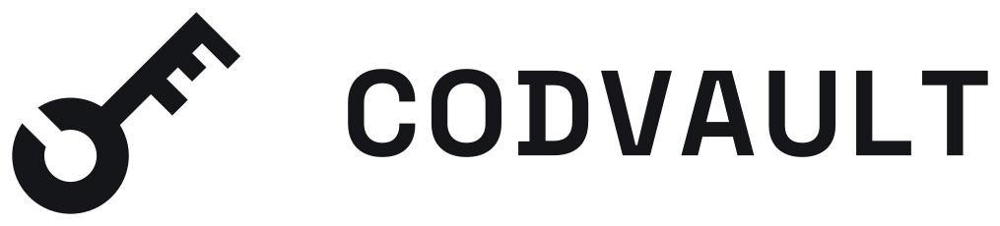
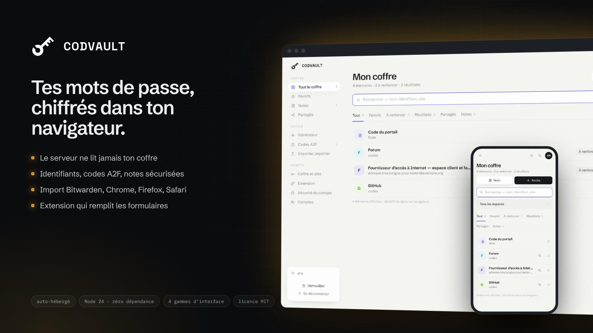
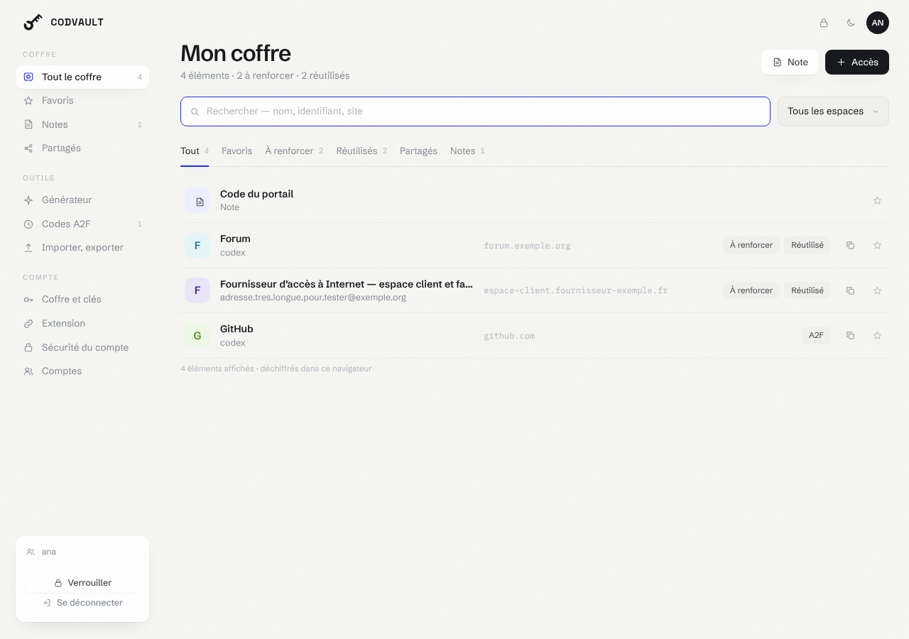
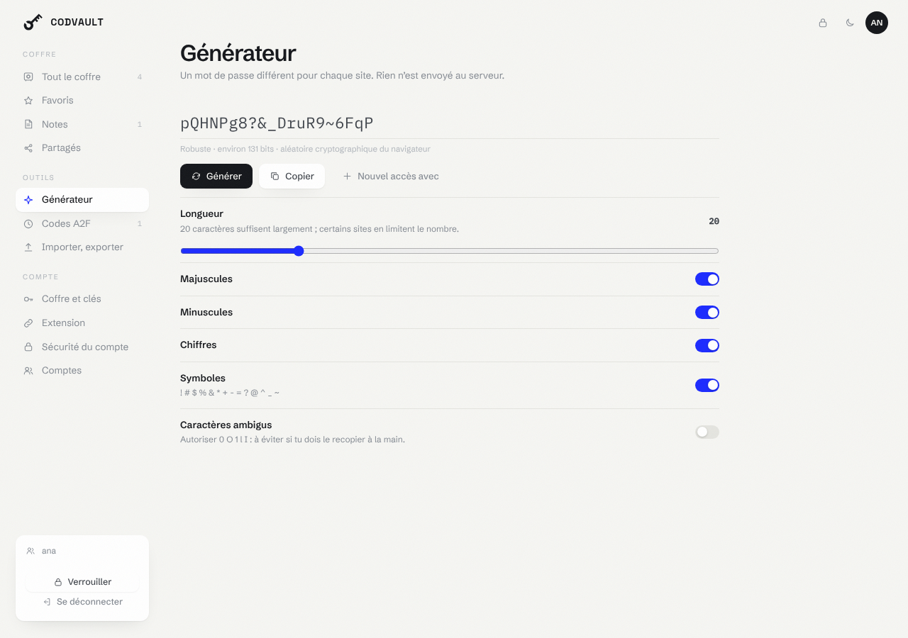
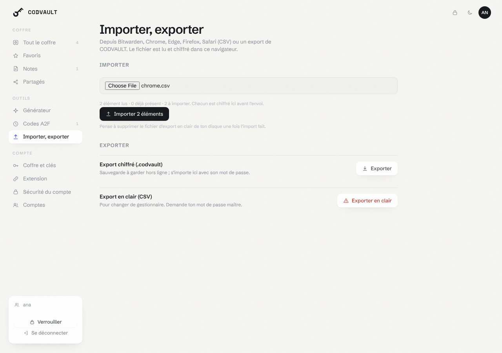
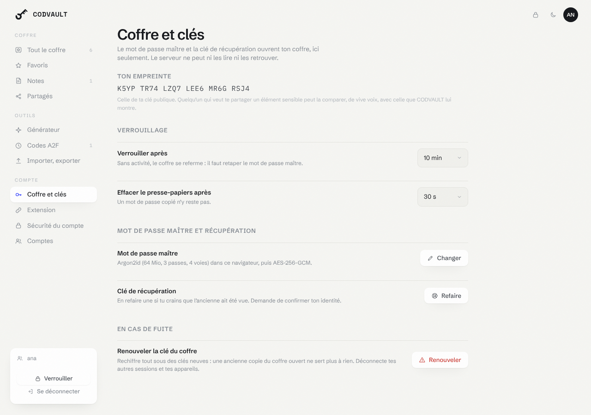
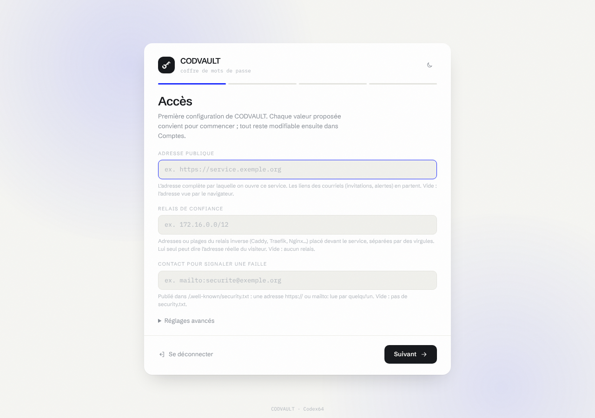

<p align="center">
  <picture>
    <source media="(prefers-color-scheme: dark)" srcset="medias/logo-sombre.svg">
    
  </picture>
</p>

<p align="center"></p>

# CODVAULT

Gestionnaire de mots de passe sous le Hub. Chaque compte a son coffre :
identifiants avec générateur, codes A2F (TOTP), notes sécurisées. On importe
depuis Bitwarden, Chrome, Edge, Firefox ou Safari, on partage un élément avec
un autre compte de la même instance, et une extension de navigateur remplit
les identifiants sur le site ouvert.

Le chiffrement se fait dans le navigateur. Le serveur ne reçoit que des blocs
chiffrés et ne peut lire ni les mots de passe, ni les notes, ni les secrets
A2F, ni les favoris. Ce qu'il voit malgré tout est écrit dans
[web/confidentialite.txt](web/confidentialite.txt).

## Aperçu

|  |
|:--:|
| Le coffre |

|  |
|:--:|
| Le générateur de mots de passe |

|  |
|:--:|
| Importer depuis un autre gestionnaire |

|  |
|:--:|
| Coffre et clés du compte |

Quatre gammes d’interface au choix — SOMA, Console, Exploitation, Lavande — en clair ou en sombre, de 360 à 1920 px de large.

## Le chiffrement

Tout est dans [web/crypto.js](web/crypto.js), sur le WebCrypto du navigateur.

Le mot de passe maître est étiré par Argon2id (64 Mio, 3 passes, 4 voies,
sel propre au coffre) puis passe par HKDF pour donner la clé qui enveloppe la
clé du coffre, 32 octets tirés au hasard. Une clé de récupération, elle aussi
de 32 octets, enveloppe la même clé : elle est montrée une fois, en base 32,
et rouvre le coffre si le mot de passe maître est perdu. Sans l'un ni
l'autre, personne ne rouvre le coffre, pas même l'administrateur.

Chaque élément a sa propre clé, enveloppée par la clé du coffre, et chaque
bloc est scellé en AES-256-GCM avec des données associées qui le lient à sa
place (compte, élément, destinataire) : un bloc déplacé par le serveur ne
s'ouvre pas. Un partage enveloppe la clé de l'élément pour la clé publique du
destinataire (ECDH P-256 éphémère, HKDF, AES-256-GCM) ; l'empreinte de cette
clé publique se compare de vive voix avant un partage sensible.

Argon2id vient de [@noble/hashes](web/vendor/PROVENANCE) 2.4.0, servi tel
que publié, empreintes vérifiées par les essais. Le serveur refuse une
enveloppe sous le plancher (19 Mio, 2 passes, 1 voie), et un coffre créé avec
des paramètres plus faibles que la cible est réenveloppé au déverrouillage
suivant.

Après une fuite possible, « Renouveler la clé du coffre » (Coffre et clés)
tire une clé de coffre neuve, rechiffre chaque élément sous une clé d'élément
neuve, réenveloppe les partages et refait la clé de récupération, d'un seul
bloc : une ancienne clé n'ouvre plus rien de ce que le serveur garde. Les
autres sessions et les appareils reliés du compte sont déconnectés.

## L'extension

Le dossier [extension/](extension/) est une extension Manifest V3 pour
Chrome, Edge, Brave et Firefox (128 ou plus). Dans CODVAULT, page Extension,
« Relier une extension » donne un code montré une fois ; collé dans
l'extension, il lui donne un jeton d'appareil qui ne lit que le coffre
chiffré. Le coffre s'ouvre dans l'extension avec le mot de passe maître, par
le même [crypto.js](web/crypto.js) que l'interface (copié par
`node outils/extension.mjs`, comparé octet pour octet par les essais).

Elle ne remplit que sur un clic dans sa fenêtre ou sur Ctrl+Maj+L : aucun
script injecté dans les pages d'avance, aucun menu posé dans les sites. Au
moment de remplir, elle vérifie que la page est en HTTPS, que c'est le cadre
principal, que le site est toujours celui de l'élément, et ne touche qu'aux
champs visibles ; le mot de passe ne va que dans un champ mot de passe. La
clé du coffre reste en mémoire de session du navigateur le temps choisi
(5 minutes par défaut, ou « à chaque ouverture »), jamais sur disque ; un mot
de passe copié est effacé du presse-papiers après 30 secondes.

Installation : Chrome, Edge ou Brave, `chrome://extensions` → mode
développeur → « Charger l'extension non empaquetée » → le dossier
`extension/`. Firefox demande une extension signée :
`node outils/extension.mjs --zip`, puis la signer en non listé sur
addons.mozilla.org (`web-ext sign --channel=unlisted --source-dir extension`).

## Les logos

Le navigateur montre d'abord les initiales du site, puis son logo si le
serveur en a un. Le serveur va le chercher lui-même sur le site (jamais
auprès d'un service tiers), en HTTPS, seulement vers une adresse publique :
chaque adresse résolue est contrôlée puis épinglée pour la connexion, les
redirections aussi. L'icône reçue est décodée (PNG, ou ICO contenant un PNG
ou un BMP), ramenée à 64 px et réencodée en PNG par
[src/image.js](src/image.js) : ce qui est servi n'a de l'original que ses
pixels. `CODVAULT_LOGOS=non` coupe toute requête sortante.

## Installation

Depuis le Hub (0.9.13 ou plus) : Catalogue → CODVAULT. Les comptes se créent
depuis le Hub, par son lien de création : installé par le Hub, CODVAULT
n'ouvre aucune page de premier lancement.

Seul, sans le Hub : `docker compose up -d --build`, avec un `.env` (voir
[.env.example](.env.example)). Le jeton d'installation du premier compte
s'affiche dans `docker compose logs codvault`.

CODVAULT doit être servi en HTTPS, ou ouvert sur `localhost` : hors d'un
contexte sûr, le navigateur ne donne ni WebCrypto ni les clés d'accès.

## Première configuration et mises à jour

Au premier démarrage, ouvre l’interface : tu crées le compte administrateur avec
le jeton d’installation (affiché dans les journaux du conteneur, ou transmis par
le Hub), tu inscris tes facteurs de connexion, puis l’**assistant de
configuration** passe les réglages de CODVAULT groupe par groupe. Il est
obligatoire : CODVAULT reste fermé tant qu’il n’est pas terminé. Chaque valeur
proposée convient pour commencer.

<p align="center"></p>

Réglages demandés : logos des sites, éléments par compte au plus, taille d’un coffre au plus (Mio) ; plus ceux de
tous les services (adresse publique, relais de confiance, gamme de
l’interface, contact de sécurité, courriels d’alerte).

Après une mise à jour qui apporte un réglage nouveau, l’assistant revient au
passage suivant d’un administrateur et ne demande **que ce réglage-là**. Une
mise à jour sans réglage nouveau ne demande rien : une fenêtre « Quoi de neuf »
résume ce qu’elle apporte, une fois par compte, et se ferme d’un clic
(`nouveautes.json`).

Tout reste modifiable dans **Comptes → Réglages du service**. Une variable
posée dans l’environnement l’emporte toujours et n’est pas demandée. CODVAULT
redémarre seul pour appliquer un changement (le processus du conteneur le
supervise). Les valeurs vivent dans `reglages.json`, dans le volume de
données ; les secrets y sont scellés par la clé maîtresse.

## Plafonds

Par coffre : 5 000 éléments (`CODVAULT_MAX_ELEMENTS`) et 64 Mio chiffrés
(`CODVAULT_MAX_MIO`). Un élément chiffré pèse au plus 100 Kio environ ; un
import compte au plus 500 éléments.

## Essais

```
npm test
cd socle && node --disable-warning=ExperimentalWarning --test test/*.test.js
```

Les essais tournent aux paramètres de production d'Argon2id, sans réglage
abaissé : une minute environ. `node outils/parcours-navigateur.mjs`
parcourt l'interface dans Chromium (Playwright requis) contre
`node outils/vitrine.mjs`, et contrôle la mise en page à sept largeurs, de 360 à 1920 px.
`xvfb-run node outils/parcours-extension.mjs` charge l'extension dans
Chromium, contre un CODVAULT et un faux site HTTPS lancés sur place.

## Sécurité

[SECURITY.md](SECURITY.md) donne l'état de chaque contrôle du référentiel
Codex64. Une faille se signale en privé :
https://github.com/CodexX64/codvault/security/advisories/new
